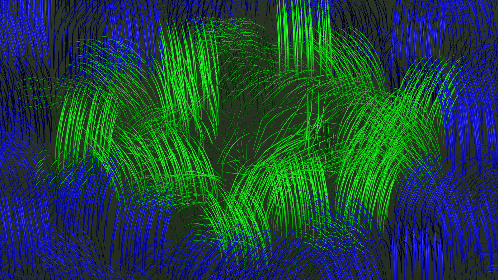
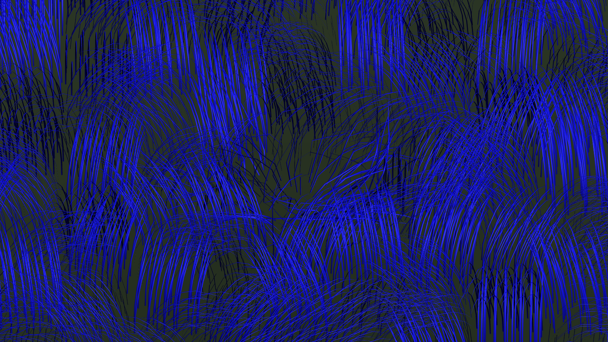

# 碰撞激活、物理收尾与延迟回收

当前 Contact Lab 使用按交互激活的 XPBD。32768 只表示模拟槽位上限；没有碰撞影响、且全部收尾结束后，活动 XPBD 降为 0。普通近、中景使用贝塞尔风响应和已有塑性。

## 生命周期

1. 注册碰撞体的保守影响区域激活草块，沿用整个兼容中景的局部查询与碰撞优先分配。
2. 草块离开影响范围后，继续完整 XPBD **2 秒**。
3. 接着用 **1 秒**从实时 XPBD 姿态过渡至带塑性的贝塞尔。整个过渡期间继续求解碰撞、弹性和塑性，显示混合不会写回物理节点。
4. 过渡结束才释放模拟槽位；GPU 上的最终压缩塑性和贝塞尔形状继续保留。
5. 过渡中再次进入碰撞范围，保留原槽位、节点、速度和塑性，取消退出。从当前显示姿态恢复到物理显示，不重新播种求解器。

时间按 60 Hz 固定模拟步推进，实际观测可能有约 1～2 个 tick 的离散偏差。这里的“碰撞结束”由注册球体/胶囊与草块保守影响区域决定，不是回读逐叶 GPU 接触结果；已经抬离整个草高的物体不会持续激活。纯外围不主动申请 XPBD。

中景最外侧的几何变形和内外层覆盖阈值也跟随退出权重，避免 52～64 米过渡带在回收槽位时直接换成外围形状。绿色仍标识实际占有 XPBD 槽位的草，包括收尾与退出阶段；蓝色为贝塞尔，橙色为外围。

## 预算与兼容性

- 不添加新的峰值调度策略，仍沿用既有 32768 槽位硬上限和碰撞优先排序。如果碰撞候选与收尾集合之和超出上限，碰撞优先排序仍可能挤出收尾；驻留页完全卸载也会终止该页状态。本轮稀疏碰撞演示未触发这种抢占。
- GPU 缓冲布局与分配容量不变，Contact Lab 总计 224852832 B（214.44 MiB，含外围）。完整历史仍预留 65536 根、主体 51 MiB；实际占用另记。
- CPU 增加每个驻留草块一个释放时刻，144×144 格共 82944 B（81 KiB）。每帧只处理局部候选及当前活动集合，正常运行没有 GPU 回读。
- `Physics.ContactDrivenSimulation` 为显式开关，仅在 Contact Lab 开启；`ContactSettleSeconds=2`、`ContactFadeSeconds=1`。原联合 baseline 与旧场景保留固定池策略，不能用较少活动草的耗时宣称达成 32768 根的 1 ms 目标。
- 修正新模式下碰撞体启用瞬间的运动历史：使用其当前位置作为起点，避免把禁用期间的零坐标当作上一帧位置。没有改变 XPBD 约束或塑性演化方程。

## 查看与复现

打开 `Assets/PBDGrass/Scenes/PBDGrassContactLab.unity` 并 Play。`C` 移除/恢复碰撞体，观察 HUD 的 contact / settling / fading 数量及约 3 秒后归零。`4` 查看整个近中景；`T` 检查流式移动后的倒伏保留。

专项菜单：`Tools/PBD Grass/Validate Contact Lifecycle`。完整场景菜单：`Tools/PBD Grass/Validate Contact Lab`。性能脚本仍在隔离项目安装时间戳插件；`wide_lifecycle` 记录碰撞、收尾、过渡和空闲阶段，`wide_fixed` 保留 32768 根的满池对照。

原始结果与复现脚本收录在 `Evidence.zip`，汇总在 `Summary.json`，最终源码指纹在 `Sources.json`。`Reference.zip` 为本轮生命周期改动前的相关实现。

## 实测表现

2026-10-21，RTX 3080 Ti，Unity 2022.3.62f2c1。专项、45 秒完整演示、历史联合 baseline 三项均通过。

- 单块离开碰撞影响后，实际在约 2.017 秒进入过渡、3.033 秒回收，包含固定 tick 和分类时序误差。过渡期间物理节点仍在运动；再次碰撞不换槽位、不重新播种，接触恢复前后的节点误差为 0。
- 32 根抽样草叶在最后回收帧的最大草尖位移约 **1.13 mm**，一秒过渡内最大单帧位移约 **3.23 cm**。这只是该专项样本，不代表任意碰撞轨迹的全局上界。
- 45 秒 / 2701 ticks 的演示中活动 XPBD 为 **0～12768 根**，9 次换页；往返前后的最大塑性量同为 1.0879096 rad。无新碰撞时，相机返回不再重新填满近景模拟池。
- 另外验证满载候选的 **32768 上限**、抬离草高后回收、退出期间再次碰撞、重叠页塑性保留、完全卸载后清零，以及中景边缘退出/再进入的 6 个内外覆盖检查点。完整历史最大驻留 32768 根，预留容量仍为 65536 根。
- 原联合 baseline 仍完整跑 32768 XPBD + 98304 贝塞尔、1440 ticks；塑性保存误差为 0。8 种草的临时重烘焙与接受资产的节点、控制点、旋转、频率、阻尼差异均为 0，资产原字节未改变。

已知专项现象：把深埋到根部的大球瞬间禁用，第一帧仍出现约 2.21 m 的弹性/接触释放位移；物理节点也出现同样幅度，发生在 2 秒收尾的开头。本轮没有修改这个物理解算现象，不能将“交接平滑”理解为所有极端接触释放都已平滑。

## 性能

同次测试、5800X + RTX 3080 Ti，D3D11，1600×900、MSAA×4，144×144 米驻留场、52～64 米中景边界、12 个碰撞体。每用例预热 120 帧，每样本严格执行一个 60 Hz tick，8 substeps × 3 iterations。下表为均值、单位 ms；活动根数为实际样本平均值。

| 阶段 | 样本 | 平均活动 XPBD | CPU Advance | GPU 求解+近景重建 | GPU 显示/中景重建 | GPU 场景总范围 |
| --- | ---: | ---: | ---: | ---: | ---: | ---: |
| 碰撞活动 | 120 | 11232 | 0.947 | 1.894 | 0.952 | 4.180 |
| 离开后收尾 | 120 | 10947 | 0.377 | 1.458 | 0.839 | 3.528 |
| 最后一秒过渡 | 60 | 10069 | 0.377 | 1.411 | 1.084 | 3.837 |
| 全部回收后 | 300 | 0 | 0.096 | 0.002 | 0.835 | 2.179 |
| 固定满池对照 | 300 | 32768 | 2.291 | 4.328 | 1.053 | 6.779 |

CPU Advance 包含池选择、交接管理与模拟提交；碰撞阶段池选择/交接管理分别约 0.256 / 0.536 ms，全回收后分别约 0.005 / 0.020 ms。整个测试 CPU 提交范围均值分别为 1.322 / 0.688 / 0.706 / 0.408 / 2.766 ms。CPU 与 GPU 是不同时间域，不能相加当作帧耗时。

GPU 求解包含融合在求解 kernel 内的近景几何重建；中景/交接显示、风响应、可见性及绘制分开记录。空闲的 0.002 ms 是空求解区间的时间戳余量，没有实际求解 dispatch。场景总 GPU 范围还包含测试场景绘制，并非独立 Player 的完整帧率。

碰撞阶段可能同时有较早碰撞留下的收尾，收尾阶段也可能有少量较早开始的退出，因此各行数量不同；逐帧 contact / settling / fading 在原始报告中保留。测量区域 900 帧均为 0 B 托管分配、0 次 GC，无时间戳丢失或失败。

**32768 根对照的 4.328 ms 仍超过 1 ms 目标。** 本轮收益来自无交互时不再维持满池，不是降低单根 XPBD 求解成本。固定 2+1 秒只是生命周期策略，不是已经物理收敛的证明；本轮没有新增 GPU 收敛判断或回读。

GPU buffer 仍分配 **214.44 MiB**，空闲归零的是活动工作量，未缩小预分配容量；CPU 仅增加释放计时数组 **81 KiB**。这不是全进程 CPU 内存或总 VRAM 统计。详细均值/P95/最大值与可复现步骤见 [Summary.json](Summary.json)、[Reproduce.md](Reproduce.md)。
