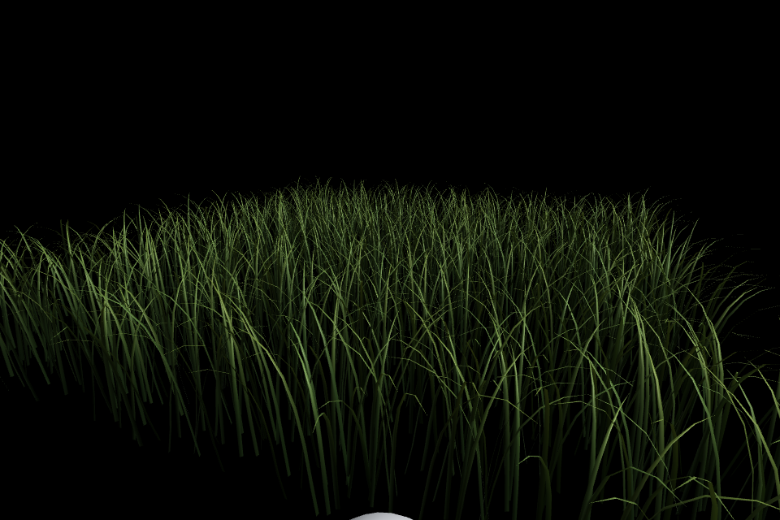
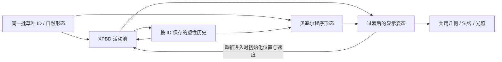
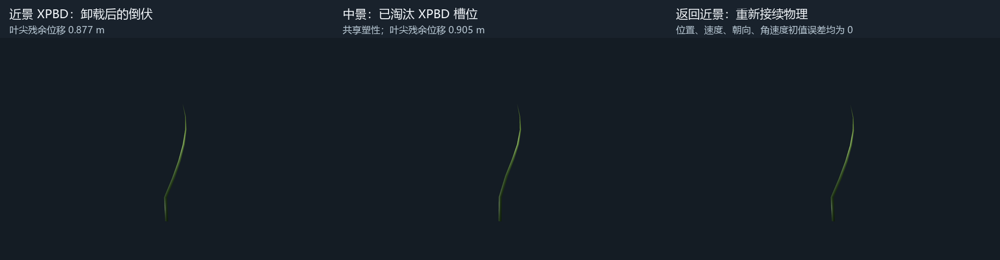

# XPBD / 贝塞尔草交接原型

## 当前要解决的事

先确认两种草可以共用身份、永久形变和渲染，再做性能优化。已接受的长叶、弹性回弹、弯曲塑性和光照继续作为外观基准；没有改动 XPBD 约束、塑性算法或光照 Shader。

独立场景 `Assets/PBDGrass/Scenes/PBDGrassHandoff.unity`：8 × 8 米、2048 根、近景激活半径 2.5 米、滞回 0.35 米、模拟池上限 1024 根。24 秒相机往返中实际活动 96～640 根，未触发容量裁剪。全部草参与正常视锥剔除和绘制，离开模拟范围的草仍然可见。

原有 `PBDGrassDemo.unity`、Prefab、物理默认参数和 32768 根完整活动标杆不变。只有新场景显式传入 `GrassHandoffSettings` 和 `GrassHandoff.compute`，才分配和执行交接资源。

**2026-10-15 补充：正常站立草的平衡姿态尚未对齐。** 用户指出出生后 XPBD 会明显二次弯折，中景程序草基本不会。隔离测试确认中景遗漏了重力弹性平衡：32 根相同草运行 8 秒，只有重力时近中景平均叶尖位置差 0.621 m；重力与默认风同时开启时为 0.521 m。下面的 0.0281 m 倒伏对照关闭了重力，不能代表默认环境的近中景差距。详见 [BirthEquilibriumAnalysis.md](BirthEquilibriumAnalysis.md)。下一步优先对齐受力平衡姿态。

## 怎么看

打开新场景并进入 Play，默认自动往返并带一个压草球。先看球经过后的倒伏，再看离开近景和返回后的形态。

| 操作 | 效果 |
| --- | --- |
| T | 自动往返 / 手动相机 |
| WASD、右键 | 手动移动和观察；Shift 加速 |
| C | 开关压草球碰撞和可见性 |
| Space | 开关风 |
| R | 清除本次运行的塑性和瞬时形变 |

选中草田对象时，Scene 视图的青色圆圈显示近景选择半径；网格滞回范围略大于圆圈。Scene 相机仍使用指定主相机剔除，不推进模拟。编辑预览不会运行物理。

## 数据和交接约定

1. **一批草。** `GrassBladeData` 的根位置、ID、尺寸、自然形态、截面和拓扑共用；没有重新随机生成第二批中景草。材质和光照代码也共用。
2. **一份材料历史。** 弯曲塑性继续按世界草叶 ID 保存，独立于 XPBD 池槽。中景只读它，不更新塑性。退出运行或显式 Reset 才清除；尚无磁盘存档或世界分块流式缓存。
3. **中景程序形态。** 从塑性偏置重建永久自然骨架，固定根和叶尖，用其余节点最小二乘拟合单条三次贝塞尔曲线。读取和物理相同的空间风纹理及滚动方向，通过可调位移和时间波形驱动控制点。它是参考对马岛思路的曲线代理，不是原游戏完整实现，也不是 XPBD 的物理解。
4. **进入。** 使用上一时刻实际显示的节点位置、速度、材料朝向和角速度，在 GPU 初始化新活动槽。未淘汰的休眠槽也重新初始化，避免直接恢复已经与画面脱节的旧运动。只有重新进入时执行这个传递，不在连续求解中拉回程序曲线。
5. **离开。** 立即停止该格 XPBD。GPU 记录当前显示形态相对程序形态的偏差，用 0.4 秒 smoothstep 消退到程序形态；程序风继续播放。中途反向切换则重新捕获当前显示形态，不从上一端点重新开始。
6. **显示。** 进入时同样用 0.4 秒从捕获形态过渡到实时物理结果。过渡后的中心线投影到原段长，材料方向与切线对齐，重建 15 顶点几何和世界法线。显示过渡不反馈给持续活动的 XPBD；只有进入时作为初始条件传入。没有固定世界位置弹簧。

运行时 CPU 只选择网格、上传网格状态和交互参数；塑性、姿态捕获、初始条件传递、曲线生成和混合都在 GPU。同步 `GetData` 仅在显式验证读取接口中使用，没有用于普通帧循环。

## RTX 3080 Ti / D3D11 验证

使用独立的 Unity 2022.3.62f2c1 验证工程，不关闭或重启用户的 Unity。原始数据见 `HandoffResults.json`，既有 32768 根回归见 `HandoffBaselineRegression.json`。

以下倒伏 / 淘汰 / 重入量化用例使用 `Gravity = 0`、关闭地面、无风，以隔离塑性传递。默认重力 / 风 / 压草球往返用例只检查有限姿态、池容量和实际激活，没有验证近中景受重力形状匹配。这是上一轮验证的缺口，不能据此判定默认环境的 LOD 姿态质量已经达标。

| 检查 | 结果 |
| --- | --- |
| 压草卸载后的近景叶尖残余位移 | 0.8773 m |
| 真正淘汰池槽，在中景停留 2 秒 | 塑性变化 0；叶尖残余位移 0.9054 m |
| 同一根已倒伏草的近中景叶尖差 | 0.0281 m |
| 返回时位置 / 速度 / 朝向 / 角速度初始化误差 | 四项均为 0 |
| 返回后 180 tick 中最大显示逐帧位移 | 0.0291 m，60 Hz |
| 返回后最大物理段长相对误差 | 0.1377% |
| 返回后最大塑性增量 | 0.0330 rad，约 1.89° |
| 过渡中连续反向切换 8 次，选择瞬间的位置跳变 | 0 |
| 休眠但未淘汰的槽重新进入 | 四项初始化误差均为 0；未恢复旧速度 |
| 整片草绘制与近景模拟分离 | 16 格可见，只有 3 格活动 |
| 默认重力 / 风 / 压草球的一次 24 秒往返 | 无无效姿态、无池容量裁剪，活动 96～640 / 2048 根 |
| 原有长叶、弹性接触、塑性、帧率一致性、32768 根和 Scene 相机回归 | 全部通过 |

这些是指定接触轨迹和相机路径的测量，不能代表任意形变的误差上界。选择瞬间的零跳变也不等于整个过渡中完全没有形状变化。

## 已知取舍

- 单条三次曲线不能精确保留复杂折痕和扭转；当前还增加保持原段长的投影，因此中景最终几何是受贝塞尔引导的带状链，未必严格落在解析三次曲线上。它保留总体倒伏，但重入后仍会产生少量物理调整和新增塑性。当前测得的 0.033 rad 增量需在后续交接质量迭代中继续压低，不能宣称材料状态在整个重入过程中完全不变。
- 当前空间风场共用，但程序位移幅度与物理风响应没有做材料响应标定。近中景摆动幅度/相位可能不同，过渡时间用于缓和差异。
- 两种表示均保留 8 节点、15 顶点，尚未实现 7 顶点中景拓扑 LOD、密度 LOD、远景、无限地形生成或 TAA 运动矢量。
- 为了让中途反向切换可重复检查，原型按整片草保存显示位置/速度/方向和过渡偏差，并每 tick 生成整片程序形态。2048 根新增 GPU 缓冲约 2.30 MiB；若直接放大到 32768 根约 36.8 MiB。正式世界系统应改为有限交接带/分块历史，不能将这版全量历史直接推广到全世界。
- 此轮没有测 GPU 时间，也没有进行 1 ms 优化。1024 根池上限及实际 96～640 根活动量仅服务交接实验，**不算完成 32768 根性能目标**。

## 后续顺序

1. 先区分材料的无载自然形态与受重力 / 风后的平衡姿态，让中景代理及 XPBD 初始条件匹配后者；补上默认环境的站立形态误差检查，再处理过渡和重入额外塑性。不要同时改物理、光照、密度和世界调度。
2. 交接约定稳定后，回到原有 32768 根完整活动场景，只优化 GPU 求解和几何重建。目标仍为 RTX 3080 Ti 每完整 tick ≤ 1 ms；同时通过已接受物理行为和交接验证。
3. 再将交接机制缩到有限边界带，接入正式中景的控制点缓存、低顶点拓扑、分块驻留和预算调度；最后确定远景表示。

运行验证：Unity 菜单 `Tools/PBD Grass/Validate Near Middle Handoff`；命令行入口为 `GrassFinal.PBDGrass.Editor.GrassHandoffValidation.Run`。可设置环境变量 `GRASS_HANDOFF_OUTPUT` 将报告和 GPU 实拍输出到 Assets 外部。原有回归菜单仍为 `Tools/PBD Grass/Validate Plastic Long Grass`。
