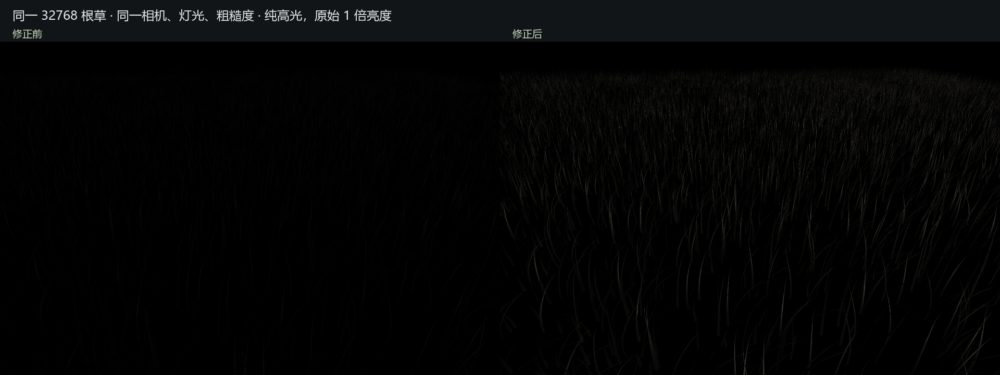
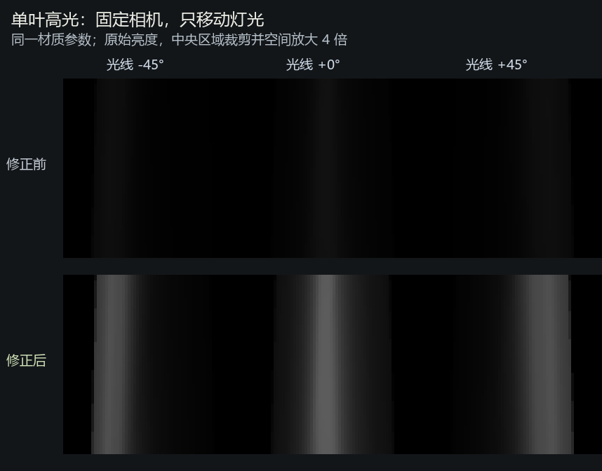

# 草叶高光缺失排查与修复

2026-10-14，Unity 2022.3.62f2c1 / Direct3D11 / RTX 3080 Ti。只修改 Assets/PBDGrass，不修改 Archive、全局色彩空间或 XPBD 求解。当前仍默认 SpecularOnly，便于继续检查。

## 查到的确定错误

当前工程使用 Gamma 色彩空间。此前自写 GGX 虽已加入 Gamma 分布项的平方根处理，Fresnel 基础反射率却仍硬编码为线性空间的 0.04；两套约定混用，使高光系统性偏弱。此前将结果解释成“高光暗”不足以定位问题。

安装的 Unity 2022.3 的 UnityCG.cginc 中，unity_ColorSpaceDielectricSpec 在 Gamma 下为 0.220916301，在 Linear 下为 0.04。UnityStandardUtils / UnityStandardBRDF 均按该常量计算反射与漫反射能量分配。

本次移除自写 GGX 分布、可见性和硬编码 Fresnel，复用 Unity 的 GGXTerm、SmithJointGGXVisibilityTerm、FresnelTerm 及 unity_ColorSpaceDielectricSpec。漫反射的 1-F0 也改用同一常量。高光函数直接返回引擎灯光强度约定下的值，避免额外乘除 pi 混淆。法线负 NdotV 的处理与 Unity Standard 的双面 normal-map 约定一致，未重新引入向视线偏转法线。

灯光强度、材质 SpecularStrength=0.7、Roughness=0.48、法线曲率、抗闪烁参数均保持不变。没有显示增益，没有用颜色加法伪造高光。

## 法线与中间项检查

将同一帧实际 GPU 输出逐项捕获：几何/模拟/圆弧/高光法线，NdotV、NdotL、NdotH、粗糙度、法线方差、像素过滤量、灯光方向/颜色、阴影衰减。

- 原始渲染法线与真实三角形几何法线的平均点积：静态 0.999123，风中 1 秒后 0.996167，未发现能解释整体高光缺失的全局反向。强变形下仍有少量插值/三角形法线偏差，未据此宣称所有法线逐点完美。
- 风中实际 NdotH 最大值 0.999982，确有叶片法线对准高光方向。
- 将光照法线强制设为 H，排除法线生成影响，修正前的纯高光峰值仍只有 0.066391，修正后为 0.366324。该对照把此次反射公式错误与法线问题分离。
- 实际灯光方向与场景方向一致，灯光颜色有效，本次默认视角阴影衰减为 1，没有因灯光向量或阴影全黑而抹除高光。

本轮没有改动几何重建或 XPBD，也没有恢复此前错误的视线法线偏置。原始世界法线和双面 BRDF 定向仍分开调试。

## 与 Unity Standard 的独立调用路径对照

临时诊断着色器另行调用 BRDF1_Unity_PBS，diffColor 和间接光均置零，仅保留主光高光；输入相同的法线、视线、灯光、粗糙度、反射率、SpecularStrength 和阴影。该路径不调用草叶的 LeafSpecular 函数。

| 色彩空间 | F0 | 与 BRDF1_Unity_PBS 最大 RGB 差值 |
|---|---:|---:|
| Gamma | 0.220916301 | 4.47e-08 |
| Linear | 0.04 | 1.49e-08 |

均在独立临时工程验证，包含静态与风中两阶段。Linear 测试只修改其独立工程设置，源工程继续使用 Gamma。不同色彩空间的 HDR 原始数值不直接比较亮度。

正式无探针着色器再次通过：高光强度置零后输出黑色、调试模式即时切换、无模拟重置/额外 tick、关灯黑色、灯光颜色/强度比例、主光阴影以及 Scene 使用主相机剔除。Shader 编译错误为 0。

## 原始亮度对比

32768 根、同一相机/灯光/确定性风模拟状态、960×640 HDR、4× MSAA。仅为捕获隐藏其他物体、使用黑背景。高光峰值从 0.054158 到 0.293573，所有图像均无额外曝光和增益。

单叶对照为一根已知正面法线的直带状叶片（0.65 米长、0.03 米基部宽、相同七段拓扑和材质）。固定叶片和相机，灯光角度 -45°、0°、+45°。高光带中心横坐标依次约 245.1、254.5、264.5 像素，随光线连续移动。下图中央区域裁剪并作 4 倍空间放大，亮度没有放大。

## 复现与范围

HighlightValidationResults.json 包含中间项统计、Gamma/Linear 参照误差、灯光回归和当前源码 SHA256。HighlightReproduction.zip 保存临时探针着色器、Editor 测试脚本、对照前版着色器和当前源文件，供独立工程复现。所有图像及缓冲读回都属于临时诊断，正式运行路径没有新增模拟回读。

当前仍是主光直接高光，没有新增天空/反射探针高光。本次修复了已证实的公式约定错误，不把它等同于已复刻完整《对马岛之魂》光照。本轮未重测 GPU 性能，历史性能报告对应原有源码快照。
