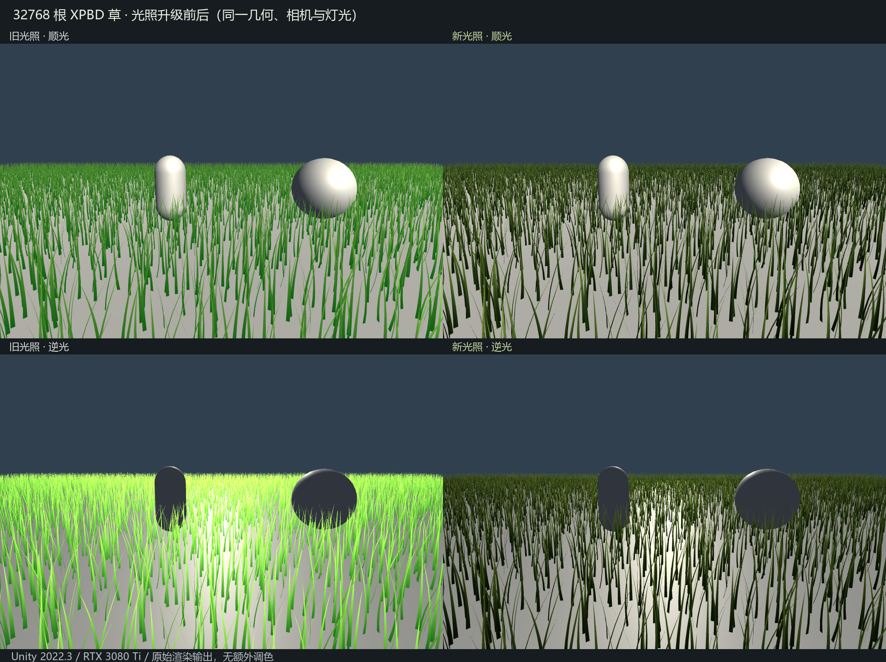

# 草叶光照升级验证

本报告记录此前光照版本；后续法线方向与相机依赖修正见 [NormalSpaceValidation.md](NormalSpaceValidation.md)。当前默认输出原始世界法线。此前“法线会变化”的测试不能证明方向正确。

2026-10-14，Unity 2022.3.62f2c1 / NVIDIA GeForce RTX 3080 Ti / Direct3D11。仅修改 `Assets/PBDGrass/`；XPBD 求解和几何重建 compute 未改动，Archive 保持原样。

## 参考与实现范围

参考 Eric Wohllaib / Sucker Punch 的 [GDC 2021 Procedural Grass in Ghost of Tsushima](https://www.gdcvault.com/play/1027033/Advanced-Graphics-Summit-Procedural-Grass)，重点为幻灯片 33–38：圆弧法线、掠射角调整、草丛法线参与高光抗闪烁、1D 光泽与叶脉纹理、2D 颜色变化、常量透射与 AO。使用原幻灯片核对，没有宣称获得原游戏完整 BRDF。

本版在 Built-in Forward 主光下实现 GGX 非金属高光、双面薄叶透射、SH 环境光、根部 AO、Unity 主光阴影和雾。掠射角调整明确是法线偏置，不是视角驱动的几何旋转；不改变 XPBD 中心线和轮廓。草丛法线使用根位置的 1.5 米空间分组作为近似，未使用原游戏的美术草丛分布。

叶脉/光泽为 256×1 纹理，颜色变化为 128×128 纹理，均带 mipmap。原材质根部直接输出颜色、逆光加色不完整乘灯光的行为已移除。双面法线不再依赖材料坐标系恰好与三角形绕序一致。

## 实际渲染

对比为静态编辑预览，不推进物理；960×640、4× MSAA，相同 32768 根草、种子、相机、环境光、地面和交互体。顺光/逆光仅改变主光方向。显示原始渲染输出，未调色或后期增强。新版同时使用本次材质预设，故这是最终效果对比，不是只替换某一个 BRDF 项的消融试验。

## 验证结果

- 实际生成/激活均为 32768 根；Shader 编译错误 0。
- 关闭主光与环境光后，草叶最大 RGB = 0，没有自发光。
- 环境光关闭时，主光从 0.5 升到 1，HDR 平均亮度从 0.016326 升到 0.032651，比例 = 2.000。
- 纯红主光时，草叶绿/蓝通道最大值 = 0，透射和高光正确跟随灯光颜色。
- 逆光图开启透射后的全图平均亮度 0.343857，关闭透射为 0.319440；薄叶透射有实际贡献。
- 开启阴影后，与无阴影图的平均亮度差绝对值为 0.004857；可接收遮挡体及草叶的主光阴影。
- Game/Scene 相机可见格均为 452；主相机移出草田并朝外后，Scene 相机绘制格为 0；渲染全过程模拟 tick = 0。
- 测试中的图像、绘制计数读回仅在临时 Editor 验证脚本使用；正式运行没有新增模拟状态回读。

## RTX 3080 Ti 性能

沿用前次直接 GPU 时间戳 / disjoint query 工具，异步 DONOTFLUSH 轮询，不读回模拟节点。1920×1080 HDR RenderTexture、4× MSAA、60 Hz、8 子步×3 次约束、32768 根全部模拟。原始记录的 `width/height=1920×1080` 是 Windows 窗口客户区，实际两台相机的 RenderTexture 均固定 1920×1080。统计不含 Editor UI 和窗口呈现，不能换算为实际编辑器 FPS。

默认 Quality 关闭阴影图；新的 ShadowCaster 仍允许草叶写入相机深度。另有单独开启软阴影/高分辨率/双级联/40 米的阶段。

| GPU 工作 | 升级前历史均值 | 新版默认均值 | 新版默认 P95 |
|---|---:|---:|---:|
| 离屏整帧 | 2.577 ms | 2.678 ms | 2.877 ms |
| XPBD 求解＋重建 | 2.127 ms | 2.142 ms | 2.345 ms |
| 不透明绘制阶段，含草/地面/交互体 | 0.209 ms | 0.230 ms | 0.233 ms |
| Hi-Z 构建 | 0.136 ms | 0.133 ms | 0.135 ms |

默认阶段合计 1200 帧（两个各 600 帧的重复）；其余对照阶段各 600 帧，实时渲染阶段 900 帧，总计 4500 条有效 GPU 样本，丢弃/失败均为 0。默认离屏总工作约 2.68 ms；旧版历史值约 2.58 ms，差约 0.10 ms，其中求解计时也有运行间波动，不能把差值全算作新 BRDF 成本。

启用软阴影图的阶段约 **2.98 ms**，P95 **3.18 ms**。这只是当前视角和 40 米双级联配置，阴影成本随可见草量、级联和分辨率变化。

## 限制与复现

这是针对公开草叶着色思路的适配，没有接入原游戏 GBuffer、SSGI、屏幕空间接触阴影或中远景。只实现主光 ForwardBase；没有 ForwardAdd 多灯叠加和反射探针高光。透射与草丛法线是可调的视觉近似，不是实测草种的光学标定。高光抗闪烁已有像素足迹/法线方差过滤，本轮未做运动序列下的客观抗闪烁指标评估。

只有主相机剔除后可见的草参与当前提交，画外草叶向画内投影可能遗漏。工程原有 Quality 关闭 Shadows，本次不修改全局 ProjectSettings；需要在 Quality 中启用阴影才能看到投影。材质参数在 Renderer 初始化时复制，编辑后重新开关 GrassDemo/重新进入 Play Mode。

原始数据：`LightingValidationResults.json`、`LightingPerformanceRaw.json`，汇总含源码 SHA256：`LightingPerformanceSummary.json`。`LightingReproduction.zip` 保存真实图像验证脚本、用于 A/B 的旧材质/着色器和本轮性能探针；GPU 原生计时插件与源码沿用 `GPUPerformanceReproduction.zip`。这些验证在独立临时 Unity 工程运行，不访问源工程 Library。

## 高光排查与修正

针对“草上没有高光，是否法线没重算”的反馈，额外读取临时工程 GPU 法线缓冲并单独捕获高光。32768 根 ×15 顶点 = 491520 个顶点，推进 60 个 tick（1 秒）后，全部顶点法线发生超过 0.01° 的变化，平均角度 22.31°。法线确实由每个模拟 tick 最后一个子步的 WriteGeometry 重建；渲染帧没有模拟推进时直接复用。

真正的问题在高光实现：初版过滤使本次视角有效粗糙度最高达到 0.847；当前工程是 Gamma，GGX 分布/可见性项却未按 Unity Standard 的 Gamma 分支处理。现已补上该分支，并把草丛混合法线过滤起点从约 5 像素叶宽收紧到约 1.3 像素叶宽，法线方差增量上限从 0.35 减至 0.06，额外像素足迹增量从 0.12 减至 0.04。

同一 Demo 相机/主光的高光单独输出，修正前峰值 0.03659，修正后 0.04332；有效粗糙度最大值降为 0.588。这是保留已解析近景叶片高光的修正，没有把所有角度都提成发亮的材质。低角度太阳测试能产生明显高光，证明 BRDF 路径有效；目前仍只有主光高光，没有天空/反射探针高光。新增 1D 高光输出、法线更新测试及复现文件保存在 LightingReproduction.zip 的 Specular 目录；数值另见 SpecularDiagnosticResults.json。

以上性能表和效果图已使用本次修正后的着色器重新测量和捕获。关灯输出、灯光颜色与强度、阴影及 Scene 主相机剔除验证仍全部通过。
