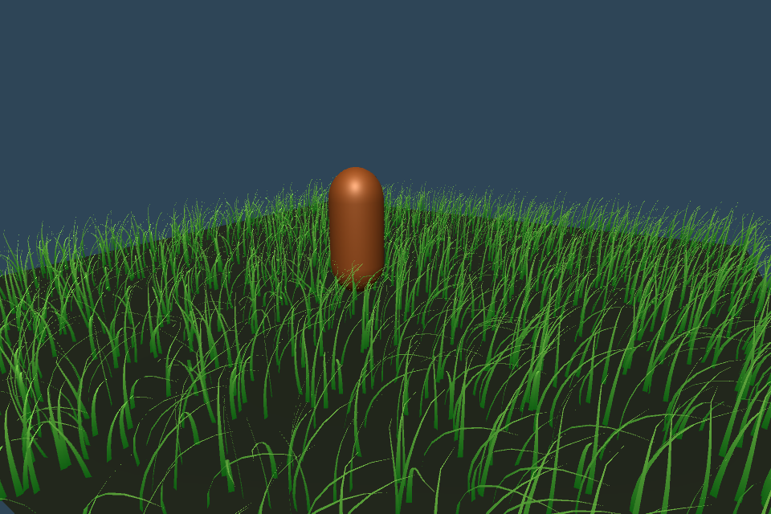

# 八节点近景 XPBD 验证

Unity 2022.3.62f2c1，NVIDIA GeForce RTX 3080 Ti，Direct3D11。当前版本全部检查通过。
验证在系统临时目录的独立 Unity 工程进行，只复制 Assets/PBDGrass；没有读取或操作源工程 Library。

## 实测

| 检查 | 结果 |
|---|---|
| 无外力 1 秒最大位置漂移 | 0.0101 mm |
| 30 / 60 / 120 FPS，风力模拟 2 秒 | 各 120 固定 tick，最大节点轨迹差 0 |
| 30 / 60 / 120 FPS，球体以 3 m/s 穿过草田 | 最大节点轨迹差 0 |
| 128 根容量的池迁移 | 未超容量；相机转动没有重置；成功迁移 |
| 有空余驻留槽时离开再进入 | 重新初始化格数 0，保留运动状态 |
| 非零原点 / 奇数尺寸 / 长帧追帧上限 | 通过 |
| 相同 1.5 m/s 速度冲击，易弯方向草尖最大投影位移 | 27.15 cm |
| 同样冲击，难弯方向 | 19.12 cm |
| 12 rad/s 扭转冲击后的材料方向平均偏转峰值 | 4.852 度 |
| 再恢复 5 秒，材料方向残差 | Quaternion.Angle 测量为 0；小于该测量的角分辨率 |
| 较硬材料（默认柔顺度乘 0.1），20 风加速度下平均草尖位移 | 3.92 cm |
| 默认材料，同样风力 | 26.85 cm |
| 默认材料，无阻挡风力下最大段长相对误差 | 0.01019% |
| 撤去风 4 秒后的平均中心线角度应变 | 0.0668 度 |
| 移动球体 / 移动胶囊体草段最大穿透 | 均为 0 mm（离散采样时刻） |
| 半径 1.2 cm 球体放在两节点中间，两个节点都不在球内 | 草段被推出，测量穿透 0 mm |
| 隔离地面摩擦测试，μ=0，一秒草尖横向滑动 | 1.5000 m |
| 同样测试，μ=0.8 | 0.5518 m |
| 可见性、所有节点有限值、根固定、材料四元数单位长度 | 通过 |
| 弯曲/扭转约束梯度与独立有限差分比较，100 组 | 最大误差 3.22e-10 |
| 切线/材料方向耦合梯度，独立有限差分 | 最大误差 2.80e-10 |

## 性能

所有草均激活，60 Hz、8 子步，每子步 3 次耦合扫掠；提交 30 ticks 后同步回读，计时除以 30。

| 规模 / 接触 | 同步平均每 tick |
|---|---|
| 8,192 根、无碰撞体 | 1.376 ms |
| 32,768 根、无碰撞体 | 4.617 ms |
| 32,768 根、一个移动胶囊体与一个移动球体 | 4.945 ms |

这些值包含 CPU 提交、池选择和结束回读，排除绘制，不是 GPU Profiler 的纯求解时间或完整场景帧率。记录只对应当前机器和测试布局。
上表测量时演示激活半径为 16 米；性能基准用 100 米半径激活整块草田。当前 Demo 场景已改为 24 米激活半径，完整生成并模拟 32,768 根草，作为后续固定性能基线。

## 实际渲染

[XPBDNearPreview.gif](XPBDNearPreview.gif) 是 Unity 相机捕获的 960 × 640、10 FPS、7 秒动画，渲染 2,048 根草。
前 1 秒受风，随后胶囊体穿过草田；3.5 秒后撤去风和胶囊体，保留重力，草叶回到重力平衡形状。

## 适用范围

这是带材料方向的八节点近景原型。柔顺度仍是有效调参值，尚未按实测草种标定；转动惯量为标量近似，风为启发式加速度。
摩擦为每次投影的 Coulomb 截断，没有跨帧静摩擦接触缓存。碰撞检测只覆盖中心线草段与球/胶囊以及水平地面，未包含整片叶面、Terrain、连续碰撞、自碰撞。
接触穿透结果是所检查离散时刻的测量，不保证任意速度和障碍布局下永不穿透。固定根点不能被接触推出。
驻留池可保留暂时离开范围的状态；容量不足被淘汰的格再次进入会重新初始化。中景、远景、边界形状混合和无限草田流式生成未接入。

原始数值见 [XPBDNearValidationResults.json](XPBDNearValidationResults.json)。菜单验证代码位于 Editor/XPBDValidation.cs。
旧四节点验证产物保留作历史对照。

## 32,768 根 Demo 与 Scene 绘制检查

实际加载当前 `Scenes/PBDGrassDemo.unity`：32 × 32 米、32 根/平方米，生成与激活均为 32,768 根，地面也改为 32 × 32 米。
主相机与类型为 SceneView 的相机分别从不同位置执行真实 Camera.Render，均捕获到草叶；两者的 GPU 可见格数均为 916。
保持 Scene 相机不动、将主相机转向草田外后，可见格数与 Scene 图像草叶像素均为 0；恢复主相机后草叶重新出现。Scene 绘制继续使用主相机的剔除参数。
编辑静态预览渲染两次后模拟 tick 数为 0；显式推进一个 tick 后再次渲染 Scene，仍为 1，没有额外模拟。禁用 Demo 后 GPU renderer 已释放。
本次验证在临时独立工程中完成；求解器、子步数和材料参数未修改，上表的模拟性能测量仍是此前记录。
