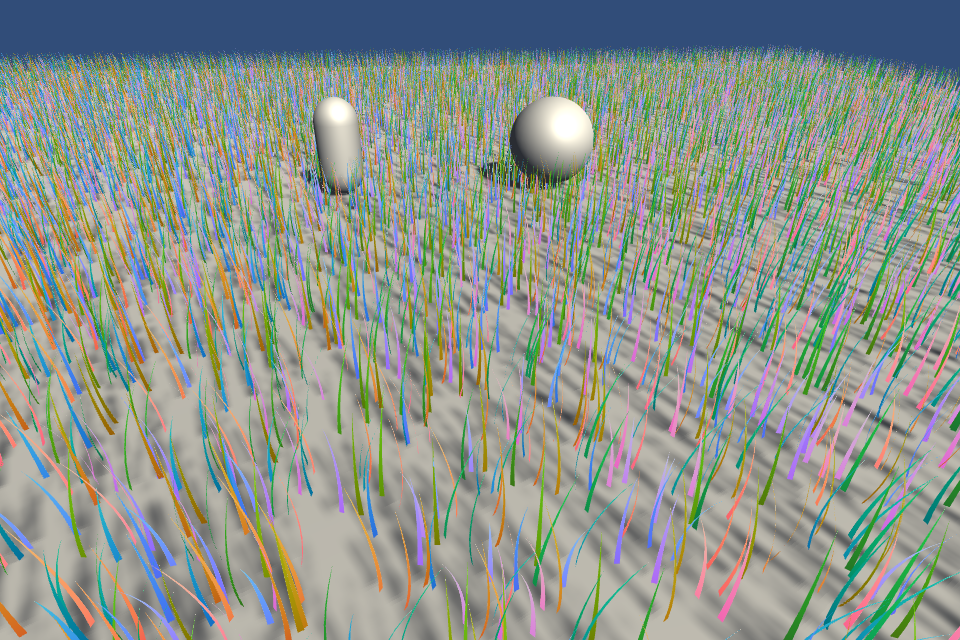
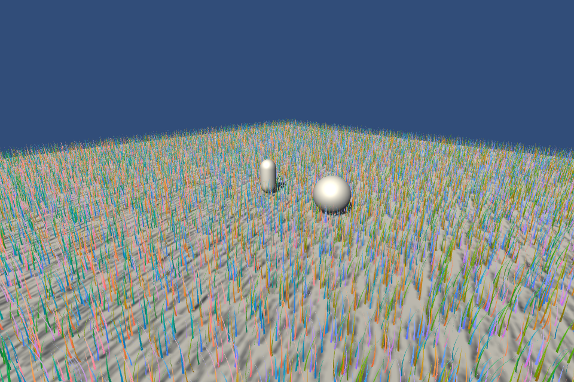

# 世界法线方向与相机不变性修正

2026-10-14。仅修改 Assets/PBDGrass；不访问源工程 Library。当前默认显示 SimulationNormals 原始世界法线。

## 确切原因

上一张图显示的是经过视线处理的高光法线，不是原始模拟法线。初版着色器使用 dot(N,V) 选择法线正负、把法线向视线倾斜，并让草丛法线向相机所在半球翻转。它们会产生随相机方位变化的 RGB 偏向，不能作为世界法线正确的证据。

还发现重建法线的叉乘顺序与三角形绕序相反。此前只验证风中法线会变化，没有验证法线方向、三角形绕序或同一世界点在不同相机下的输出，验证范围不充分。

## 修改

- WriteGeometry 改为 cross(width, tangent)，渲染正面法线与三角形绕序一致。只改变输出法线，不改 XPBD 积分、材料坐标系、节点位置或拓扑。
- 删除 dot(N,V) 法线定向和自行添加的 GlancingCorrection 视线偏置。
- 草丛法线按叶片原始正面法线的半球定向，不再按相机定向。
- 双面 BRDF 使用 SV_IsFrontFace，只在光照阶段按三角形正反面翻转。
- Debug View=1（默认）：原始 GPU 世界法线；2：世界空间圆弧正面法线；3：过滤后的正面法线；4：双面 BRDF 实际使用的法线；0：正常光照。

模式 1/2 不含相机定向。模式 3 的像素足迹过滤量仍可能随相机距离、投影改变，这是抗闪烁的 LOD 行为。模式 4 会随可见三角形正反面翻转，是明确隔离的双面光照行为。不要用不同相机的整张图逐像素比较：投影、覆盖和遮挡会改变；应比较同一世界表面点。

## GPU 验证

独立 Unity 2022.3.62f2c1 工程，Direct3D11，RTX 3080 Ti，32768 根草。

- 抽样 11514 个实际 GPU 重建三角形。修正前几何法线与输出法线的平均点积 -0.999322，反向 11514 个；修正后平均点积 0.999322，反向 0 个。
- 固定草叶，只移动相机并重新绘制，GPU 原始法线缓冲最大差值 0，模拟 tick 从 0 到 0。
- 用同一固定世界法线 (0,0,1) 的合成三角形作对应点测试。相机分别位于左右、前后四个位置；模式 1/2/3 在禁用过滤时均输出约 (0.5,0.5,1)。旧模式 2/3 的红通道在左/右相机下约 0.448/0.553，还会在背面观察时翻转蓝通道。
- 强制完整草丛过滤、保持过滤量相同：旧模式 3 左/右相机的绿通道为 0.116622/0.883227；修正后四个相机均为 0.889711。这复现并消除了草丛法线按相机选择半球造成的颜色偏向。
- 模式 4 在合成三角形正面输出 (0.5,0.5,1)、背面输出 (0.5,0.5,0)，确认正反面与几何绕序一致。
- Shader 编译错误 0。正常光照模式下的关灯输出、灯光颜色/强度比例、主光阴影和主相机控制 Scene 剔除验证仍全部通过。

## 当前原始世界法线

两张图均不推进模拟。视角改变会改变屏幕中所见表面和覆盖率；RGB 编码的每个世界表面法线不因此被重定向。

原始数值见 NormalSpaceValidationResults.json；正常光照回归见 NormalSpaceLightingRegression.json；源码摘要见 NormalSpaceSourceHashes.json。NormalSpaceReproduction.zip 含验证脚本、用于对照的旧着色器/compute 和当前源文件，均只用于独立临时工程。诊断回读不在正常运行路径中。

本轮没有重新进行 GPU 性能统计，也不据此宣称高光视觉问题已完全解决。此前 LightingValidation.md / LightingPerformanceSummary.json 对应此前源码快照，应按历史数据阅读。
