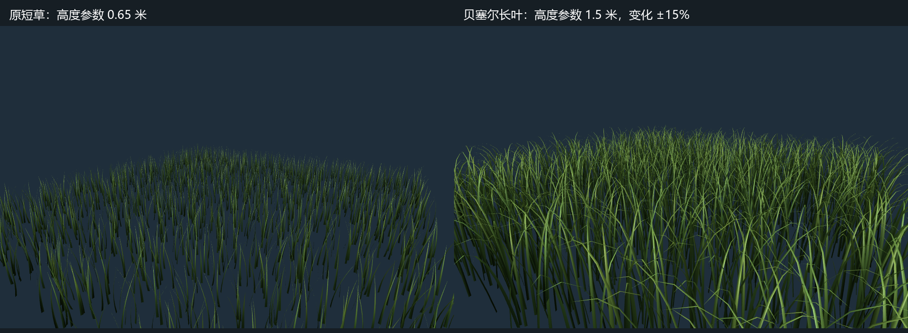
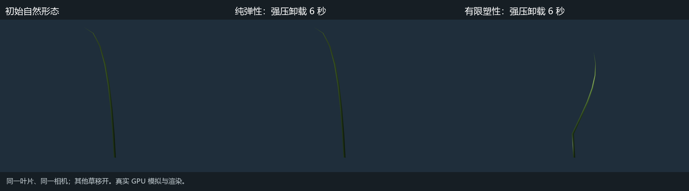
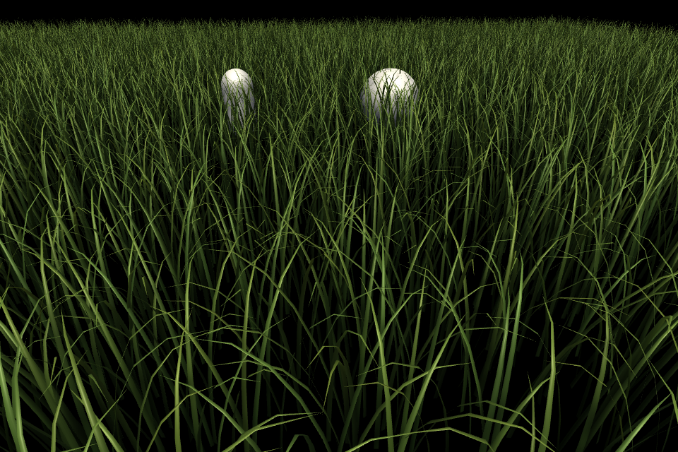

# 长叶与有限弯曲塑性

2026-10-15，基于 `baseline/xpbd-grass-pre-optimization` 的工作版本。所有产品改动位于 `Assets/PBDGrass/`，Archive 未修改。

用户已认可本版塑性倒伏效果，并将后续 RTX 3080 Ti / 32768 根活动草的 GPU 求解＋几何重建预算定为每完整 tick 1 ms。本报告 2.457 ms 是本版实测，不代表已达到新预算。

## 当前 Demo

- 入口仍为 `Scenes/PBDGrassDemo.unity`，32×32 米、32 根/平方米，共 32768 根全部活动；60 Hz、8 子步、每子步 3 次约束。
- `GrassDemo.BladeShape` 使用三次贝塞尔定义自然中心线，加入高度/宽度/朝向变化、倾斜、前弯和轻微侧弯。基础高度参数 1.5 米，变化 ±15%；首个 32 根样本叶尖高度为 1.106–1.507 米，旧参考高度参数为 0.65 米。轮廓保留 8 节点、7 段和 15 顶点，没有用额外顶点数换取效果。
- 参考对马岛之魂公开的贝塞尔叶形建模思路；曲线只用于生成自然形态，动态中心线和材料方向由 XPBD 求解，不在渲染阶段叠加另一套风摆。
- 长叶按实际宽度轮廓估计质量/截面缩放，并调整有效柔顺度：易弯 3、难弯 0.2、扭转 1、基部 0.08。风仍为 `(10,0,3)` 的启发式加速度，不是实测空气动力学。
- 保留当前材质、光照、隐藏地面、黑色背景与太阳旋转等已接受的场景配置。剔除范围改为依据叶片弧长的保守包围范围，避免长叶弯曲或伸出原格时被错误剔除。

## 塑性模型与生命周期

叶身使用曲率屈服阈值 2.5 rad/m、流动速率 6 /s、最大塑性曲率 4 rad/m；基部单独设置 40° 屈服、50° 最大塑性倾角。关节以相邻段平均长度将角变形换算成曲率；单关节塑性角另有 1.2 rad 上限。

每个物理子步完成弹性和接触求解后，使用局部旋转向量的两个弯曲分量估计超额弹性变形，以 `1-exp(-rate*h)` 积累有界塑性偏置。下一子步使用新的自然相对方向。塑性演化不在约束迭代循环内重复累计，扭转、段长仍为弹性。这是简化率相关弯曲材料，不是完整连续体返回映射或经真实草种标定的损伤模型。

塑性状态独立于模拟槽位，按稳定草叶 ID 存在 GPU。每关节 float4，当前草田增加 3.5 MiB；模拟槽位被淘汰后，偏置仍保留，重新进入时按塑性自然形态重建节点和材料方向，速度归零。保留的是自然形态，不是淘汰前的瞬时振动。

无自动愈合、拉伸塑性、断裂或草间碰撞。停用 `EnablePlasticity` 可忽略偏置用于弹性对照。`GrassDemo` 组件菜单 `Reset Grass Deformation` 清除偏置并重置所有驻留槽。状态只保留在当前渲染器生命周期，退出 Play、组件重建后清除；没有持久化到磁盘，也没有接入中远景。

正常模拟、初始化和槽位管理没有同步回读节点或塑性数据。新增读取 API 仅供 Editor 验证使用。

## 真实 GPU 验证

Unity 2022.3.62f2c1、Direct3D11、RTX 3080 Ti。在系统临时目录的独立 Unity 工程复制当前资源后验证，未访问源项目 Library。新验证菜单为 `Tools > PBD Grass > Validate Plastic Long Grass`，环境变量 `PLASTIC_GRASS_OUTPUT` 可指定结果目录。

| 检查 | 结果 |
|---|---:|
| 无外力静止形态、弱风 4 秒 | 无塑性累积 |
| 小球轻触节点位移 | 20.036 mm |
| 轻触卸载 6 秒后的叶尖残差 | 0.098 mm，无塑性 |
| 强压弹性对照，卸载 6 秒后叶尖残差 | 4.443 mm |
| 强压塑性版本，压住时叶尖位移 | 1.882 m |
| 同一强压过程，卸载 6 秒后的残余位移 | 1.158 m，保留部分弯曲 |
| 强压后叶长相对误差 | 最大约 0.000077% |
| 淘汰槽位后，原草叶塑性数据误差 | 0 |
| 重新进入后的叶尖残余位移 | 0.912 m |
| 清除形变 | 原始形态恢复，塑性数据为 0 |
| 相同接触轨迹，30/60/120 FPS | 塑性旋转向量最大差异 0.000107 rad |
| 完整 32768 根，默认重力与风 3 秒 | 无塑性累积；最大段长相对误差 0.0122% |
| 主相机 / Scene 相机可见格数 | 613 / 613 |
| 编辑预览的模拟 tick | 0 |
| 主相机转离草田 | Scene 草也按主相机剔除 |

强压探针是半径 0.38 米球体在约 0.65 米高度持续压入的压力测试，不代表普通角色每次接触都会留下 1 米以上残差。残差是叶尖到原位置的三维距离，不是塑性伸长。

旧弹性验证另行关闭塑性、显式保留原形态与原材料参数，完整回归通过：静止漂移、固定时间、方向性弯曲、扭转恢复、球/胶囊整段接触、地面摩擦、模拟池与追帧上限。该测试中的同步耗时含 CPU 与结束回读，不作为 GPU 性能结论。

原始新验证数据见 `PlasticGrassResults.json`，旧弹性回归见 `PlasticElasticRegression.json`。

## GPU 成本对照

对同一份当前长叶求解器，只切换 `EnablePlasticity`；使用保存 Demo 的 32768 根、8×3 配置与固定交互体。临时副本在子步提交循环前后加入 D3D11 时间戳；查询采用异步 DONOTFLUSH 轮询，不读取模拟或塑性缓冲。Editor 以小离屏目标推动命令执行，测量区间只含求解与最后子步的几何重建，不含草的绘制、CPU 池管理、Editor UI 或窗口呈现。

| 配置 | 样本数 | 均值 | P95 |
|---|---:|---:|---:|
| 关闭塑性 | 300 | 2.379 ms | 2.473 ms |
| 开启塑性 | 300 | 2.467 ms | 2.557 ms |
| 关闭塑性，重复 | 300 | 2.411 ms | 2.547 ms |
| 开启塑性，重复 | 300 | 2.447 ms | 2.554 ms |

每阶段预热 120 个 tick。合计 1200 条有效样本，丢弃/失败为 0；两轮合并后关闭为 2.395 ms、开启为 2.457 ms，差约 0.062 ms（2.6%）。这是当前版本的开关对照，**不等于相对优化前 baseline 的全部增量**：新 Kernel 的寄存器分配等成本可能在关闭分支时也存在，且叶形/材料参数已改变。本次也没有测量大量运动碰撞、持续全场屈服或完整游戏帧。

测试时用户的其他 Unity 工程保持原状，存在后台 GPU 负载；时间戳只包围本次命令，但调度与频率仍会影响绝对值。两轮交替采样用于观察波动，不把该数值当作独占 GPU 上限或 FPS。

原始采样、汇总与源码哈希见 `PlasticGrassPerformanceRaw.json` 和 `PlasticGrassPerformanceSummary.json`。复现包 `PlasticGrassPerformanceReproduction.zip` 只供独立临时工程使用；产品目录没有加入原生计时插件或性能挂钩。

## 图像

图像来自真实 GPU 渲染。单根对照为了看清轮廓，移开其他草并使用独立测试相机/灯光；Demo 图使用保存场景的光照与材质。没有改动生产材质来强化塑性差异。
