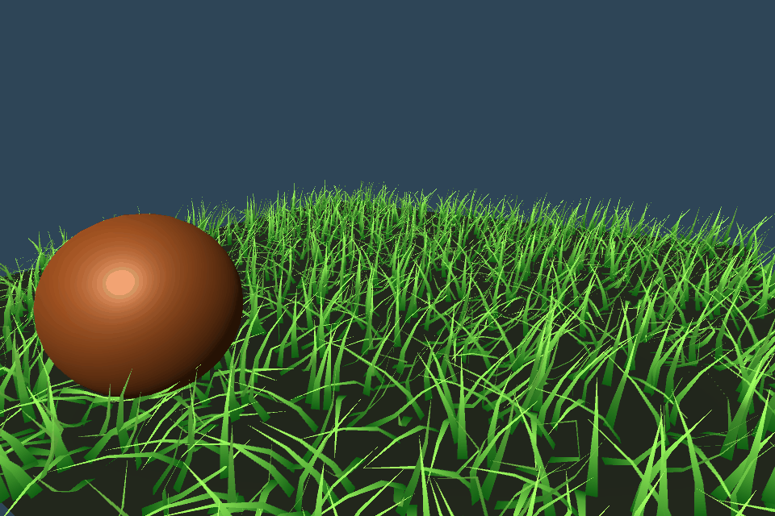

# XPBD GPU 验证记录

设备：NVIDIA GeForce RTX 3080 Ti，Direct3D11，Unity 2022.3.62f2c1。全部检查通过。
自动验证在系统临时目录中的独立 Unity 工程运行，没有读取源工程 Library。

| 检查 | 结果 |
|---|---|
| 无重力、无风、无接触，1 秒最大位置漂移 | 0.0913 mm |
| 30 / 60 / 120 FPS，模拟 2 秒 | 各 120 个固定 tick，节点位置差均为 0 |
| 8 子步，风加速度 20，段长最大相对误差 | 0.0851% |
| 4 子步远 LOD，同样受风 | 段长最大相对误差 0.2865% |
| 弯曲柔顺度 0.001 | 平均角度应变 0.3046 度 |
| 弯曲柔顺度 0.01 | 平均角度应变 2.5366 度 |
| 撤风后 4 秒 | 平均角度应变 0.001442 度 |
| 移动球测试，10 tick 一次采样 | 最大节点穿透量 0.000000 m |
| 撤去球体后 4 秒 | 段长最大相对误差 0.5481% |
| 奇数尺寸网格、非零原点、追帧上限 | 通过 |
| 32,768 根，全部 8 子步 | 1.398 ms / tick |
| 131,072 根，全部 8 子步 | 6.138 ms / tick |

计时是 30 个 tick 的批次平均值，包含 CPU 提交与结束时同步回读，不包含草叶绘制，不是 GPU Profiler 数据或完整场景 FPS。
根部固定与节点有限性在测试中检查。GPU 的 5 个 Compute 内核和实际草 Shader 均完成编译，间接绘制捕获已检查。
弯曲梯度还通过 100 组随机三点的有限差分比对，最大差异约 2.61e-10。

## 预览

预览区域为 8 × 8、2,048 根草；按真实模拟时间展示 5 秒，依次为风场、球体经过、撤去风与球体后恢复。
预览包含向下重力；材料响应和卸载测量则关闭重力，以单独测量内部弹性。
恢复检测针对自身曲率，而不是要求每个点返回旧的世界坐标。当前中心线角度模型没有扭转约束，因此天然曲叶可绕基部切线转动；点位移不能直接作为弯曲刚度的度量。

实际源工程的 Play Mode 交互仍可通过演示场景检查；此记录中的 GPU 运行和图像来自独立测试工程。
