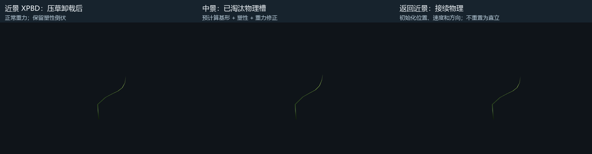

# 预计算风响应与塑性倒伏的近中景交接

后续优化使用 [CombinedBaseline.md](CombinedBaseline.md) 中的 32768 根 XPBD + 98304 根外围贝塞尔联合场景；本文的 2048 根场景继续作为细节诊断。

打开 `Assets/PBDGrass/Scenes/PBDGrassBakedHandoff.unity`，进入 Play。自动相机带着压草球往返：附近使用 XPBD，远离后使用程序草代理；倒伏后的材料历史在两种表示之间保留。

| 按键 | 操作 |
| --- | --- |
| T | 自动往返或手动相机 |
| C | 开关压草球，便于观察卸载后的形状 |
| Space | 开关风 |
| G | 随机风或固定风 |
| R | 清除塑性、瞬时形变和风响应状态 |
| WASD、右键、Shift | 手动移动、观察和加速 |

2048 根草、8 × 8 米、近景半径 2.5 米，滞回 0.35 米，池容量 1024 根。默认选用已接受对照中的第 6 种“长、窄、软”草作为整片材料，每格采用一个固定随机朝向。24 秒自动往返中实际活动 96～640 根，其余可见草停止 XPBD。

原有 `PBDGrassDemo.unity` 的 32768 根标杆、旧交接场景、八种草的并排对照场景和 8 份预计算资产继续保留。本场景先验证单一已标定材料的交接，尚未混合 8 种物理材料同时驻留。

## 接入方式

**重力与风。** 中景使用同一份预计算控制点、材料方向、响应频率和阻尼。每格一个 float4 保存两个风响应量和速度，持续更新，不因格子退出物理池而暂停。世界风先转换到格子的材料朝向，再查询响应表，输出时转回世界坐标。空间风纹理与 XPBD 共用；中景在格中心采样，XPBD 在每根草根部采样。

**塑性。** 永久弯曲仍保存在按草叶 ID 索引的原 GPU 缓冲。中景只读取，不演化塑性，也不把临时碰撞位移存成永久倒伏。真实淘汰、缓存槽恢复和中途反向交接都沿用同一份材料历史。

**倒伏后的受力。** 倒伏改变重力力臂，不能直接把“完好草的受力姿态”叠加到塑性上。倒伏分支使用下游节点力矩，修正相对完好草的弹性弯曲；力矩与弯曲的关系从现有 25 个预计算样本估计。它执行有界静力近似，不在中景运行 XPBD、积分节点惯性或求解碰撞。完好草仍走已接受的预计算风响应。

静力近似目前使用 24 次松弛更新、每轴弹性角限制 ±1.2 rad。它并非完整非线性杆的平衡求解。中景倒伏草另有默认 1 rad/s 的显示旋转速率限制，使用已有显示姿态作历史，避免在折叠附近快速改变形状；不修改材料历史。位置交接仍使用 0.4 秒混合，速率限制可能让倒伏草的最终调整持续更久。

**重新进入。** GPU 用当前实际显示的位置、速度、材料方向和角速度初始化 XPBD。物理求解继续围绕原自然曲率加塑性约束运行，不添加固定位置弹簧。显示混合不持续反馈到活动物理中。

运行帧没有同步 GPU 回读。CPU 选择网格并上传交互输入；姿态捕获、风状态、塑性修正和交接在 GPU 完成。验证里的读回只用于诊断。

## 验证范围

测试采用 Unity 2022.3.62f2c1、RTX 3080 Ti、D3D11。站立和倒伏测试均开启正常重力与地面，使用匹配第 6 种草的质量和柔顺度；重度压草后撤去碰撞并等待卸载，再真正淘汰物理槽并返回。

原始结果、回归结果、源文件校验值与 GPU 实拍放在 `BakedHandoffValidation/`。相同负载下的形状差、选择瞬间的连续性、整个返回过程中的逐帧运动分别测量，不能互相替代。

| 检查 | 结果 |
| --- | --- |
| 16 个格朝向下，站立草随机风平均叶尖差 | 约 1.43 cm |
| 站立草随机风最大采样叶尖差 | 约 5.09 cm |
| 普通重力和风下的塑性峰值 | 0 |
| 无风出生后 3 秒，最大节点继续位移 | 约 2.32 cm，含曲线拟合的物理调整 |
| 轻触后退出，塑性峰值 | 0；中景恢复到未受碰撞形态 |
| 无风重度倒伏，近中景最大节点差 | 约 5.93 cm |
| 带风重度倒伏，近中景最大节点差 | 约 7.86 cm |
| 物理槽淘汰期间，材料历史变化 | 0 |
| 重新进入时位置、速度、方向、角速度初值误差 | 四项均为 0 |
| 单根倒伏草返回后，最大逐帧节点位移 | 无风约 5.8 mm，带风约 8.4 mm，60 Hz |
| 上述返回用例的新增塑性 | 0 |
| 过渡期间反向切换，选择瞬间的位置跳变 | 0 |

数值对应指定材料和接触轨迹，不是所有塑性形状的误差上界。完整场景还检查 24 秒随机风与移动压草球往返、池容量、有限姿态和主相机控制的 Scene 视图剔除。正在发生碰撞的活动草仍可能快速运动，不能把单根卸载重入的毫米级位移外推为全场运动峰值。

完整往返中，已离开过渡期的中景草最大节点位移为约 0.100 m / 0.1 s；碰撞中的活动草最大值约 1.57 m / 0.1 s。两者均为 10 Hz 采样，前者用于排查中景静力近似的突变，后者包含直接碰撞响应，不作为 LOD 跳变的测量。

## 当前取舍

程序草以贝塞尔受力形态为基形，再组合分段塑性、静力近似、原段长和地面修正；严重倒伏后不保证仍能用单条三次贝塞尔精确表示。这一实现尚未压缩成正式中景的低顶点表示。

近景保留完整 XPBD，离开近景立即停止它；倒伏分支的静力计算与显示历史也有开销。本轮验证效果和交接，没有测 GPU 时间。32768 根完整模拟 tick ≤ 1 ms 的目标保持不变，不能用本场景的少量活动草宣称达标。

目前只标定和验证第 6 种材料的塑性交接；其他尺寸、柔顺度、异常大风、强烈扭转、地形坡度及连续尺寸插值仍需进一步验证。有限草田的显示历史仍按整片分配，还没有做世界分块和交接带内存优化。

## 重新生成与检查

菜单 `Tools/PBD Grass/Create Baked Wind Plastic Handoff Scene` 重新生成独立场景，保留其他场景。`Tools/PBD Grass/Validate Baked Wind And Plastic Handoff` 运行功能验证；设置环境变量 `BAKED_HANDOFF_OUTPUT` 可将输出放到 Assets 以外。

批处理入口是 `GrassFinal.PBDGrass.Editor.BakedGrassHandoffSceneBuilder.Create` 和 `GrassFinal.PBDGrass.Editor.BakedGrassHandoffValidation.Run`。批处理会创建或打开测试场景并退出 Unity，建议在独立验证工程执行。
