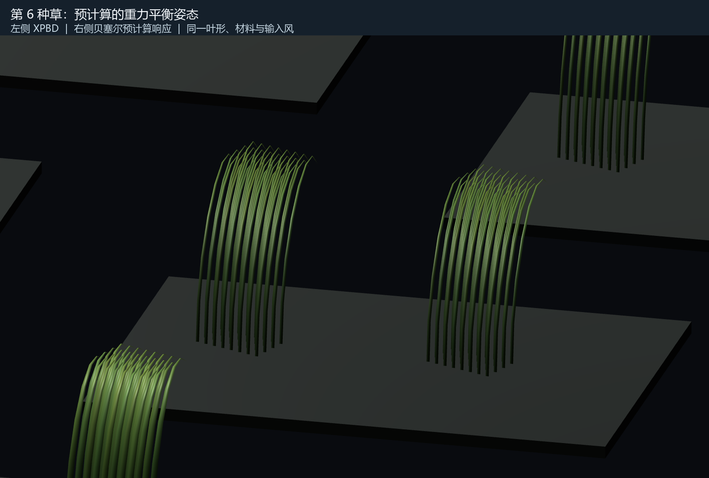
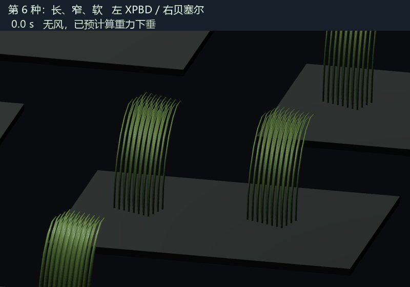

# 八种草叶的预计算风响应对照

本对照继续用于优化时的烘焙与风响应回归。实际联合负载基准是 [CombinedBaseline.md](CombinedBaseline.md) 中的 32768 根 XPBD + 98304 根外围贝塞尔草。

打开同目录的 `GrassResponseComparison.unity` 并进入 Play。每个台座左侧运行 XPBD，右侧使用预计算贝塞尔形态和少量动态状态。两侧草叶尺寸、材料、朝向、光照和输入风相同，都从带重力的无风平衡姿态出生。

| 按键 | 操作 |
| --- | --- |
| 1～8 | 近看对应草型 |
| 0 | 查看全部草型 |
| Space | 开关风，观察回弹 |
| G | 切换为持续随机风 |
| R | 回到预计算的无风平衡姿态 |
| WASD、右键、Shift | 移动、观察、加速 |

默认先静止 3 秒，再依次开启风、停风、反向吹风，20 秒后使用随机风。随机风用固定种子生成，便于重复对照；贝塞尔运行时读取当前风向和风力，未保存这段风的动画。

近看使用正交相机，避免左右位置的透视差异影响弯曲对照；总览使用透视相机。

## 八种草与预计算数据

8 种来自两档长度、两档宽度、两档柔顺度的组合：高度参数 0.95 / 1.5 m，半宽 0.014 / 0.026 m，柔顺度为原长叶参数的 0.65 / 1.3 倍。质量随长度和宽度变化。所有叶形均使用相同的自然曲线规则；演示固定同一朝向，逐根不再随机缩放，便于比较。

每种离线运行原有 GPU XPBD，保存水平风加速度 X、Z 分量各为 `-8、-4、0、4、8` 的 25 个平衡姿态。风输入单位沿用现有求解器的加速度，不是 m/s。烘焙与对照都关闭塑性，没有碰撞对象；重力和地面保持开启。

每个采样保存 8 个节点、7 个材料方向和拟合得到的三次贝塞尔控制点。无风采样用于初始化 XPBD 的位置和方向，原来的材料自然曲率仍然保留，没有把平衡姿态改成约束的自然姿态。

额外记录两个水平轴的开启风阶跃响应，拟合每种草的响应频率与阻尼。运行时 GPU 每种草只维护一个 float4：两个等效风响应量、两个变化速度。先更新它们，再查询平衡形态表生成贝塞尔。这一演示共有 8 个 float4 动态状态；右侧没有运行 XPBD、逐节点积分或约束求解。

贝塞尔中心线采样后保持原段长、处理地面，并重建宽度与世界法线。材质使用现有草叶光照。普通帧循环没有同步 GPU 回读；烘焙和验证中的读回只用于离线采样与测量。

## 对照结果

Unity 2022.3.62f2c1，RTX 3080 Ti，D3D11。512 根总量：左侧 256 根 XPBD，右侧 256 根贝塞尔。每种每侧 32 根相同朝向的草，使用均匀风场，以排除空间采样差异。测量每种第一根代表草，移除两侧根位置偏移后比较；同组草的材料与输入相同。

| 编号 | 高度 半宽 柔顺度 | 无风叶尖差 cm | 随机风平均差 cm | 快速阵风最大差 cm |
| --- | --- | ---: | ---: | ---: |
| 1 | 短 窄 硬 | 0.86 | 0.85 | 1.24 |
| 2 | 短 窄 软 | 0.87 | 0.85 | 3.23 |
| 3 | 短 宽 硬 | 0.86 | 0.86 | 2.94 |
| 4 | 短 宽 软 | 0.85 | 0.84 | 5.80 |
| 5 | 长 窄 硬 | 1.26 | 1.32 | 3.28 |
| 6 | 长 窄 软 | 1.12 | 1.17 | 6.40 |
| 7 | 长 宽 硬 | 1.19 | 1.18 | 5.53 |
| 8 | 长 宽 软 | 0.45 | 0.66 | 11.43 |

无风启动后推进 3 秒，XPBD 叶尖最大继续位移 1.35 mm，消除了从无载自然姿态出生时的大幅重力下垂。贝塞尔与 XPBD 仍存在曲线拟合误差：无风时节点最大位置差约 0.8～2.3 cm。

测试包含两次恒定风、停风、反向风、18 秒平滑随机风，以及 12 秒每 0.35 秒突然换向的阵风。动态误差每 6 个 60 Hz tick 采样一次，因此表中峰值是 10 Hz 采样峰值，不是逐物理子步的严格最大值。8 种草、200 个平衡采样的终态节点速度均小于 0.002 m/s。

原始结果在 `Validation/Results.json`；原有 32768 根塑性长叶回归结果在 `Validation/BaselineRegression.json`。当前求解器、光照和原 Demo 配置保持不变。此轮没有测 GPU 时间，未推进 32768 根 ≤ 1 ms 的优化目标。

## 这版的范围

这个场景继续独立验证“预计算平衡形态，加运行时简化风响应”。塑性倒伏、随机格朝向和空间风场已经在新增的 `Scenes/PBDGrassBakedHandoff.unity` 接入近中景交接，说明见 [BakedHandoff.md](BakedHandoff.md)。连续尺寸插值和混合材料交接尚未接入。

最软长草的重力平衡已明显下垂，部分风采样涉及地面；它的两个轴阶跃响应未必能由单个线性二阶模型精确描述，快速阵风下误差最大。大风超出表格范围时查表会钳制，不能视为任意强度风的物理预测。

这套风响应已获用户确认；8 份预计算资产和这个并排对照继续作为风响应基准。交接效果在新增场景单独检查。

## 重新生成

- `Tools/PBD Grass/Bake Eight Response Types`：离线烘焙 8 份资产，使用当前 GPU XPBD 采样，可能需要数分钟。参数组合定义在 `GrassResponseBaker.BakeType`，修改此处后重新烘焙；直接修改 Baked 资产的形态或物理参数不会自动更新响应表。
- `Tools/PBD Grass/Create Eight Type Comparison`：从已烘焙资产生成对照场景。
- `Tools/PBD Grass/Validate Eight Type Response`：运行数值对照并输出截图。环境变量 `GRASS_RESPONSE_OUTPUT` 可将验证输出放到 Assets 以外。

批处理入口分别为 `GrassFinal.PBDGrass.Editor.GrassResponseBaker.Bake`、`GrassResponseSceneBuilder.Create` 和 `GrassResponseValidation.Run`。批处理会使用空场景或指定对照场景并退出 Unity，建议在独立验证工程运行。
